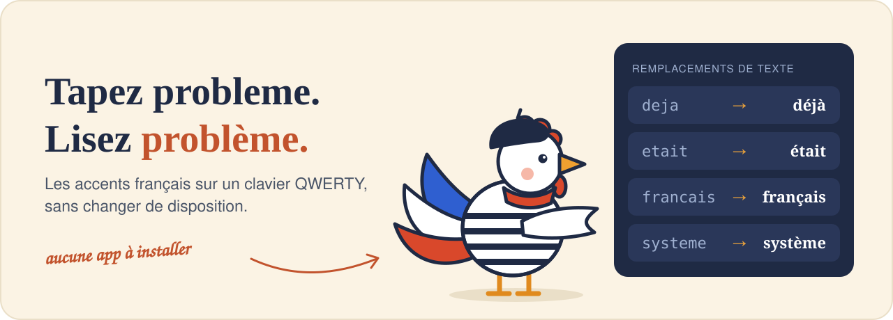

<p align="center">
  
</p>

<h1 align="center">french-qwerty</h1>

<p align="center">
  <b>Écrire en français avec ses accents sur un clavier QWERTY, sans y penser.</b><br>
  Une liste de mots à importer dans les remplacements de texte de macOS, iPhone et iPad.
</p>

<p align="center">
  <a href="#installation-mac">Installation</a> ·
  <a href="#les-règles">Les règles</a> ·
  <a href="#proposer-un-mot">Proposer un mot</a> ·
  <a href="#english">English</a>
</p>

---

Vous avez un Mac avec un clavier américain (QWERTY) et vous écrivez en français ?
Taper `é`, `è`, `à` ou `ç` demande un appui long ou une combinaison de touches, alors
on finit par écrire « probleme » et « deja ».

Avec ce repo, vous tapez le mot sans accent et macOS le corrige tout seul :

| Vous tapez | macOS écrit |
|---|---|
| `probleme` | **problème** |
| `deja` | **déjà** |
| `etait` | **était** |
| `francais` | **français** |
| `voila` | **voilà** |

Pas de disposition de clavier à apprendre, pas de touche morte, aucune app à installer :
c'est la fonction *Remplacements de texte* déjà présente dans macOS. La liste complète
est dans [`mots.txt`](mots.txt).

## Installation (Mac)

1. Téléchargez [`french-qwerty.plist`](french-qwerty.plist) (bouton de téléchargement en haut à droite de la page du fichier).
2. Ouvrez **Réglages Système → Clavier → Saisie de texte → Remplacements de texte…**
3. Glissez le fichier `.plist` dans la liste qui s'affiche.

Les remplacements se synchronisent avec iCloud : ils arrivent aussi sur votre **iPhone**
et votre **iPad**.

Pour mettre à jour, refaites la même chose avec le nouveau fichier. Pour retirer un
mot, sélectionnez-le dans la liste et cliquez sur **−**.

> Dans certaines apps, il faut activer **Édition → Substitutions → Remplacement de texte**.

## Les règles

La liste doit pouvoir être installée les yeux fermés, y compris par quelqu'un qui écrit
aussi en anglais. Un mot n'entre que s'il respecte les trois règles :

1. **Sans accent, il n'existe pas en anglais.**
   `selection` → sélection est refusé : il casserait « selection » dans un texte anglais.
2. **Sans accent, il n'existe pas en français.**
   `foret` → forêt est refusé : un foret est aussi un outil.
3. **Il n'a qu'une seule forme accentuée courante.**
   `ameliore` est refusé : impossible de savoir si vous vouliez « améliore » ou « amélioré ».
   C'est pour cela que la liste contient surtout des noms, des adverbes et des infinitifs,
   et très peu de verbes conjugués.

Une forme concurrente très rare (« maniéré » face à « manière ») ne bloque pas un mot
courant ; cela se discute au cas par cas.

Les mots refusés sont conservés dans [`exclus.txt`](exclus.txt) avec leur raison, pour
ne pas refaire le débat.

### Et pour les autres mots ?

Les mots ambigus (`a`/`à`, `ou`/`où`, `ameliore`) ne seront jamais dans la liste. Pour
eux, sur un clavier américain sous macOS :

| Accent | Raccourci | Exemple |
|---|---|---|
| aigu | `Option` + `e`, puis la lettre | é |
| grave | `Option` + `` ` ``, puis la lettre | è à ù |
| circonflexe | `Option` + `i`, puis la lettre | ê î ô |
| tréma | `Option` + `u`, puis la lettre | ë ï |
| cédille | `Option` + `c` | ç |

Ou maintenez simplement la touche de la lettre appuyée.

## Proposer un mot

Ce repo vit de vos propositions : chaque mot ajouté profite à tout le monde.

**Sans rien installer** : [ouvrez une issue « Proposer un mot »](../../issues/new?template=proposer-un-mot.yml).

**Ou directement** : modifiez [`mots.txt`](mots.txt) depuis GitHub (icône crayon) et
ajoutez votre mot, **avec ses accents**, à sa place alphabétique. Une ligne, un mot :

```
problème
```

C'est tout : le raccourci sans accent (`probleme`) est déduit automatiquement, et le
fichier `.plist` est régénéré après la fusion. Ne le modifiez pas à la main.

Chaque proposition est vérifiée automatiquement (doublons, ordre, mots exclus). Les
règles 1 à 3 sont vérifiées par un humain : dites-le dans votre proposition si vous
avez un doute.

Pour vérifier en local :

```bash
python3 scripts/build.py
```

Sur Mac, le script signale aussi les mots qui semblent exister en anglais.

## English

**french-qwerty** lets you type French with correct accents on a US QWERTY keyboard
on macOS, iPhone and iPad, without switching keyboard layout or installing an app.

It is a community-maintained list of French words for the built-in macOS
*Text Replacements* feature: type `probleme`, `deja`, `francais` and macOS writes
**problème**, **déjà**, **français**.

- **Install**: download [`french-qwerty.plist`](french-qwerty.plist), open
  *System Settings → Keyboard → Text Input → Text Replacements…* and drag the file
  into the list. It syncs to iPhone and iPad through iCloud.
- **Safe for bilingual typing**: a word is only accepted if its unaccented form is
  not an English word, is not another French word, and has a single common accented
  spelling. `selection` and `meme` are deliberately left out.
- **Contribute**: add one accented word per line to [`mots.txt`](mots.txt), or open an issue.

## Licence

[MIT](LICENSE)
